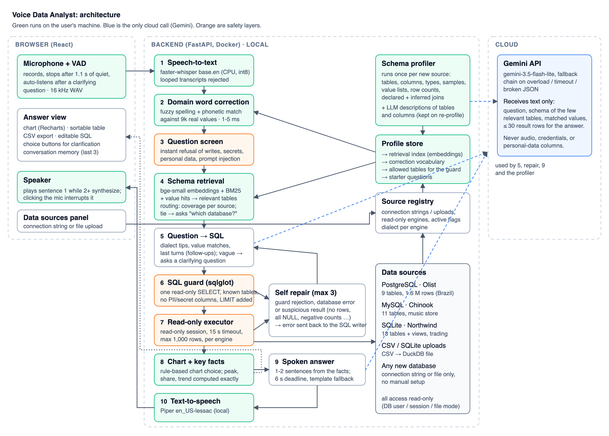

# Voice Data Analyst: Project Report

**Course:** Natural Language Processing, Complex Computing Problem (CCP)
**Project:** Project 4, Voice Data Analyst

| Name | Registration number |
|------|---------------------|
| Noman Ahmed | 22i-2563 |
| Zain Abbas | 21i-1109 |

---

## 1. Introduction

Voice Data Analyst lets a person **talk to a database**. The user asks a business question out loud, for example *"Which payment type is used most often?"*, and the system:

- understands the spoken question,
- finds the answer in the database,
- shows it as a **chart and a table**, together with the **SQL it ran**,
- and **speaks a short summary** of what matters.

The user never writes SQL. Speech recognition and speech synthesis run **on the user's computer**. Only the SQL writing uses a cloud language model (Google Gemini).

The system works with a database it has never seen, from just a connection string or a file. Our demo connects three databases on three different engines: **Olist** (Brazilian e-commerce, the dataset named in the brief, about 1.6 million rows) in PostgreSQL, **Chinook** (a music store) in MySQL, and **Northwind** (a trading company) in SQLite. Users can also upload CSV files.

---

## 2. System Overview

The system has three parts:

- **Browser (React):** records the voice, shows the conversation, chart and table, and plays the spoken answer.
- **Backend (Python, FastAPI, in Docker):** does all the processing, locally.
- **Gemini (cloud):** writes the SQL and words the spoken answer. It receives text only.

**When a database is connected (once):** the system studies it (tables, columns, values, links between tables) and prepares a search index and a list of real names.

**When a question is asked (every time), ten steps run in order:**

1. Speech to text
2. Fix misheard names
3. Safety check on the question
4. Find the right database and tables
5. Write the SQL
6. Safety check on the SQL
7. Run the query (and repair it if needed)
8. Choose the chart and compute the key facts
9. Write the spoken answer
10. Speak it

*Figure 1: System architecture. Green parts run on the user's computer, blue is the cloud language model, orange are the safety layers.*

---

## 3. Core Modules

### 3.1 Voice input
The browser records the microphone and stops automatically after **1.1 seconds of silence**. The audio is sent to **Whisper** (`base.en`, via faster-whisper), which runs locally and turns it into text in about **0.6 seconds**. If Whisper produces nonsense (repeating the same words), the system asks the user to say it again.

### 3.2 Domain word correction
Speech models often mishear names: "Curitiba" becomes "Kuretiba". Before any SQL is written, the transcript is compared with about **9,300 real values** from the database (cities, products, artists, categories), both by **spelling** (RapidFuzz) and by **sound** (Metaphone). A misheard name is replaced only when the match is strong, and ordinary English words are never changed. This takes 1–5 ms.

### 3.3 Schema understanding
When a database is connected, it is **profiled automatically**: tables, columns, types, sample values, and relationships, including links that are not declared (found by matching names and values). Gemini also writes a one-line plain-English description of each table and column, which helps with confusing names. For each question, a hybrid search (meaning, keywords and real values) picks **only the few tables that matter**, usually about six, because a large schema does not fit in a prompt.

### 3.4 Multiple data sources
Users can connect **PostgreSQL, MySQL and SQLite** databases with a connection string, and **upload CSV files** (stored as DuckDB). All connections are **read-only**. The system decides which database holds the answer by checking how much of the question each one can account for. If two fit equally well, it **asks the user** which one. It then writes SQL in the right **dialect** for that engine. Any database can be switched off, and a switched-off database is never used.

### 3.5 Question to SQL
Gemini receives the question, the selected tables, matching data values, and the last few questions (for follow-ups). It returns one SQL query. Rules in the prompt make it aggregate when needed, use the real values from the data, and treat dates like "last quarter" relative to the data.

### 3.6 Self repair
If a query **fails**, is **blocked**, or returns something **suspicious** (no rows, all blanks, negative counts, percentages above 100), the error is sent back to Gemini to fix the query. There are **at most 3 attempts**. Unsafe queries are never "repaired".

### 3.7 Spoken clarification
For vague questions such as *"show me the top customers"*, the system does not guess. It asks a short question by voice: *"By total spending, or by number of orders?"*. Then it **turns the microphone on automatically** and listens for the answer. It never asks twice about the same question.

### 3.8 Chart, table and spoken explanation
Simple rules choose the chart from the result: a **big number**, a **line chart** for trends, or a **bar chart** for comparisons. A sortable table and the **SQL** are always available. The system computes the key facts itself (peak, average, share, trend), and Gemini turns them into one or two sentences, such as *"Orders peaked in November 2017, about twice the monthly average."* The table is never read aloud. The voice is produced locally by **Piper**.

### 3.9 Voice follow-ups
The last three questions and their SQL are kept. When the user says *"now break it down by month"* or *"same for last year"*, the system **edits the previous query** instead of starting over.

### 3.10 Evaluation
We wrote four evaluation scripts that measure word correction, response time, attack handling and answer accuracy. The results are in Section 6.

---

## 4. Setup

**Requirements:** Docker (or Colima on macOS) and a Gemini API key.

1. Copy `.env.example` to `.env` and add the Gemini API key.
2. Run `docker compose up --build -d`. This starts the backend, the frontend, PostgreSQL and MySQL.
3. Run `./scripts/seed_all.sh` once to load the demo databases. Olist's CSV files are downloaded from Kaggle into `data/olist/` first.
4. Open **http://localhost:3000**.

The speech models download automatically on the first start and then work offline. A new database is added from the **"Add a data source"** panel with a connection string or a file. No other setup is needed.

---

## 5. Technical Details

| Part | Technology | Runs |
|---|---|---|
| Speech to text | faster-whisper (`base.en`) | Local |
| Text to speech | Piper (`en_US-lessac-medium`) | Local |
| Name correction | RapidFuzz, jellyfish (Metaphone), wordfreq | Local |
| Table search | fastembed (bge-small), BM25 | Local |
| SQL safety check | sqlglot (reads SQL as a syntax tree) | Local |
| Databases | PostgreSQL, MySQL, SQLite, DuckDB via SQLAlchemy | Local |
| SQL writing and spoken wording | Google Gemini (`gemini-3.5-flash-lite`, with backup models) | Cloud |
| Backend / frontend | Python FastAPI / React, TypeScript, Recharts | Local |

**Safety layers.** Four independent layers stop dangerous requests:

1. **Question screen:** refuses requests to delete or change data, reveal passwords, or ignore instructions.
2. **SQL check:** only one read-only `SELECT`, only real tables, no dangerous functions, no listing of private data (emails, phones, customer names), and a row limit.
3. **Read-only connection:** the database itself refuses any change.
4. **Limits:** 15 seconds and 1,000 rows per query.

**What goes to the cloud.** Only text: the question, the few selected tables, and at most 30 result rows. Never audio, passwords or private columns.

**Reliability.** If Gemini is busy or slow, a backup model is tried automatically. If the spoken answer takes more than 6 seconds, the system speaks the computed facts directly.

**Testing.** 266 automated tests cover every step.

---

## 6. Evaluation Results

All results are from the final version of the system.

| What we measured | Result |
|---|---|
| **Names correct**, real speech-recognition errors (41 names) | **20% before correction → 66% after** |
| **Names correct**, typical mishearings (22 names) | **5% → 95%** |
| Normal questions wrongly changed by the corrector | **0 of 12** |
| **Time** from the end of the question to the first spoken word | **3.5 seconds** (median) |
| **Attack questions** handled safely (32 spoken, 15 raw SQL) | **47 of 47**, and no database row was changed |
| **Correct answers** (36 questions, 3 databases) | **89%** exact, **97%** when a ranked list with the right answer first counts |
| Follow-up questions answered correctly | **9 of 9** |
| Vague questions that got a clarifying question | **5 of 5** (and 0 of 36 clear questions) |
| Questions sent to the wrong database (48 questions) | **0** |

**Where the 3.5 seconds go:** waiting for silence 1.1 s, Whisper 0.6 s, Gemini writing the SQL 1.0 s, Gemini wording the answer 0.6 s, first audio 0.1 s. All other steps together take less than 0.1 s.

---

## 7. Critical Analysis

### 7.1 Problem Statement
Most business data is stored in databases, but most people who need answers **cannot write SQL**. They depend on analysts or on dashboards that only answer questions planned in advance. Speaking a question is the most natural way to ask, especially for people away from a keyboard or with limited computer skills.

Standard solutions do not solve this:

- **Business-intelligence tools** (such as Power BI Q&A) need each dataset prepared by an expert first, and they are typed, not spoken.
- **Plain AI text-to-SQL** guesses when a question is vague, cannot fit a large database in its prompt, and has no protection against dangerous queries.
- **A normal voice assistant** mishears the most important words, the names of products, places and people, so they never match the data.

What is missing is a system that works on **any database**, understands **spoken** questions even when names are misheard, **asks instead of guessing**, answers **by voice**, and is **safe by design**.

### 7.2 Complexity Drivers

- **Errors build up across steps.** One misheard word leads to a wrong value, an empty result and a confident wrong answer. Each step must catch the mistakes of the step before it.
- **Conflicting requirements:**
  - *Fast vs. accurate:* every extra check or AI call slows the conversation.
  - *Asking vs. guessing:* the system must ask when unclear, but asking about everything is annoying.
  - *Useful vs. private:* staff names in a report are fine; a list of customers' names is not.
  - *Local vs. quality:* speech must run on a laptop, which means a smaller, less accurate model.
- **No obvious solution.** There is no standard way to decide which database a question belongs to, or when a question is vague. We turned both into rules and measured them.
- **Unknown databases.** Nothing can be written for a specific database; everything must work from the data alone, across four SQL dialects.
- **Many parts must work together** within a few seconds: ten steps, two local AI models, four database engines and one cloud service.

### 7.3 Design Justification

| Alternative we considered | Why we rejected it | What we chose instead |
|---|---|---|
| Send the **whole database schema** to the AI | Large databases do not fit, and extra tables cause wrong joins | Send only the few tables that matter |
| Let the **AI decide what is safe** | AI instructions can be tricked; in our own test the AI turned a blocked "show emails" query into "show customer names" | Four fixed safety layers that do not depend on the AI |
| Let the **AI fix misheard names** | It does not know the real values, is slower, and changes correct words | A local matcher against the real database values |
| Use **cloud speech recognition** (e.g. Deepgram) | The rules require local speech, and the user's voice would leave the computer | Whisper and Piper running locally |
| **Answer from the best-matching database** instead of asking | Faster, but it is guessing, which the brief does not allow | Ask the user, but only on a genuine tie and once per topic |

### 7.4 Trade-off Analysis

| Trade-off | Our choice | Reason |
|---|---|---|
| Speech accuracy vs. speed | Whisper `base.en` (0.6 s) instead of `small.en` (1.7 s) | `small.en` got 73% of names right against 66%, but adds over a second to every question; the name corrector closes much of the gap |
| Asking vs. guessing | Ask only when the answer would really change | Asking too often is annoying; guessing gives wrong answers |
| Natural answer vs. speed | AI writes the answer, with a 6-second limit and facts we compute ourselves | Sounds natural, numbers are always exact, and the user is never kept waiting |
| Privacy vs. usefulness | Allow totals and staff names; block listing customers' private details | Most business questions need totals, not individuals |
| Safety vs. flexibility | Read-only, one query, 1,000 rows, 15 seconds | A voice assistant on an unknown database must never change or overload it |
| Free AI service vs. reliability | A fast model plus backup models | The free service is often busy; backups keep the system working |

### 7.5 Societal and Ethical Impact

- **Privacy.** Business databases often contain personal data. The system only shows totals or non-personal information; emails, phone numbers, addresses and customer names can be counted but not listed. Only text is sent to the cloud, never the user's voice. Organisations using it must still follow data-protection laws such as the **EU GDPR** and **Pakistan's proposed Personal Data Protection Bill**.
- **Voice recording.** Audio is processed on the user's computer and not stored. Users should always know when the microphone is on, especially because it turns on automatically after a clarifying question.
- **Safety.** Talking to a database creates new risks, such as tricked or disguised delete requests. Our safety layers stopped all 47 attacks we tested, and the read-only connection protects the data even against attacks we did not think of.
- **Over-trust.** A spoken answer can sound confident and still be wrong (our accuracy is 89–97%). The system shows the SQL, states its assumptions and asks when unsure, but important decisions should still be checked by a person.
- **Fairness and accessibility.** The English speech model works less well for some accents, so some users may face more mistakes; correcting names against real data reduces this. On the positive side, people who cannot write SQL, or who have visual or mobility impairments, can now explore data by voice.

---

## 8. Limitations and Future Work

- About a third of heavily mispronounced names still cannot be recovered; a larger speech model would help on faster hardware.
- Response time depends on the cloud AI service, which is sometimes slow.
- The test sets are small and written by us; a public benchmark would give stronger evidence.
- Private data is detected by column names; data hidden inside free text may be missed.

---

## 9. References

1. Radford et al., *Robust Speech Recognition via Large-Scale Weak Supervision* (Whisper), 2022.
2. Yu et al., *Spider: A Large-Scale Human-Labeled Dataset for Text-to-SQL*, 2018.
3. Li et al., *BIRD: A Big Bench for Large-Scale Database Grounded Text-to-SQLs*, 2023.
4. *Routing End User Queries to Enterprise Databases*, arXiv 2601.19825, 2026.
5. Olist, *Brazilian E-Commerce Public Dataset*, Kaggle.
6. Piper text-to-speech; faster-whisper; sqlglot; fastembed (BGE embeddings).
